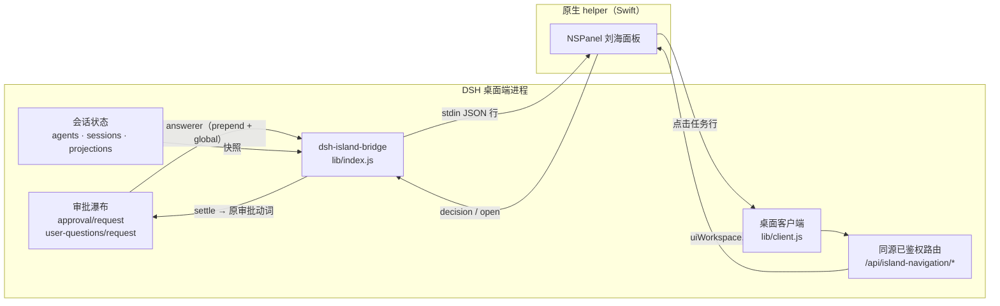

# dsh-island-bridge

> 把 [DeepSeek Harness](https://github.com/deepseek-ai) 的会话状态与待审批操作，投影到 macOS 刘海上的**原生灵动岛**——审批在岛上直接裁决，点一行跳回那个对话。

[](https://github.com/JiayangSUNwinter/dsh-island-bridge/actions/workflows/ci.yml)
[](LICENSE)
[](#环境要求)
[](#环境要求)

---

## 这解决什么问题

并行开几个 Agent 会话时，人常常不在 DSH 窗口前：

- **审批看不见** → 工具审批积压在会话里，Agent 空转等人；
- **任务找不回** → 切走再回来，要靠回忆哪个会话在跑、跑到哪了；
- **现有手段不够** → 系统通知（如 dsh-notify-me）无法就地裁决，网页浮层被窗口遮挡就消失。

`dsh-island-bridge` 用一颗系统级、原生、**数据不出本机**的悬浮面板同时盖住这两件事。

| 方案 | 任何 App 前台可见 | 可就地裁决 | 数据出本机 |
|---|---|---|---|
| 系统通知中心 | ✓ | ✗ 第三方 App 不支持交互按钮 | 视实现 |
| DSH 页面内浮层 | ✗ 窗口被遮挡即不可见 | ✓ | ✓ |
| 云中继 + 手机推送 | ✓ | ✓ | ✗ 经第三方云 |
| **本项目（原生刘海面板）** | ✓ | ✓ | ✓ 仅 stdio / 同源路由 |

## 特性

- **审批不漏，岛上即决**：`allowed-once` / `rejected` 与原审批瀑布动词一致，不产生额外权限语义。
- **审批独占**：只要有待交互，整颗岛只显示审批（来源、队列、完整正文、按钮），不夹带运行任务与完成提示。
- **全文可读**：正文在岛内滚动，不截断；按钮钉在底部，不会被正文滚走。
- **点击即达**：点任务行或审批来源 → 唤醒 DSH 并精确打开对应会话（不经窗口猜测）。
- **完成提示**：会话结束时同一岛上出一条 24pt 单行提示，3 秒后自动收回，连续完成不叠窗。
- **单实例、可自愈**：宿主只托管一个 helper 进程；崩溃重启有退避与预算，迟到事件不影响新进程。
- **动态高度**：1 项 96pt / 2 项 124pt / 3 项 152pt，上限 178pt 后内部滚动。

## 工作原理



- 桥接以 **answerer** 身份加入审批瀑布，岛上裁决与本地 UI 竞速，本地先答就用本地结果。提问只镜像到岛上并跳回 DSH 回答；答案、取消和超时保持 DSH 原有语义，交互结束立即清理岛上的提示。
- 面板通过 **stdio JSON 行**与宿主机通信；helper 二进制首次运行时由 `swiftc` 编译并按源码哈希缓存。
- 导航复用 DSH 已有的**同源、已鉴权** Fetch 通道，不新开端口、不注册公网入口。

## 环境要求

| 项 | 要求 |
|---|---|
| 系统 | macOS 14+（Apple Silicon 优先；需要带刘海的屏幕效果最佳） |
| DSH | 桌面端 `>= 0.2.1-rc.2` |
| 工具链 | Xcode Command Line Tools（首次运行 `swiftc` 编译原生面板）：`xcode-select --install` |
| Node | ≥ 22（DSH 自带运行时即可，仅测试与脚本用到） |

## 安装

### 桌面端（推荐）

在 DSH 的**插件管理页**里从 GitHub 安装 `JiayangSUNwinter/dsh-island-bridge`，然后重启 DSH。

### 命令行

```bash
# 从 GitHub 安装
dsh plugin --profile desktop add github:JiayangSUNwinter/dsh-island-bridge

# 或从本地仓库根目录安装（开发用）
dsh plugin --profile desktop add link:"$PWD"
```

装完重启 DSH。`dsh plugin` 会把参数转发给 pnpm，并在成功后把包名写进 profile 的 `dsh.profile.bundles`；本包的 `cordis.patch.yml` 经 `dsh.bundle.patch` 声明，作为组合层随该 bundle 加载。

<details>
<summary>手动注册（插件列表里看不到、或宿主日志没有 <code>[island-bridge]</code> 时）</summary>

以桌面 profile 为例，三处都要在，缺一不生效：

1. 包目录可被解析：`~/.dsh/profiles/desktop/node_modules/dsh-island-bridge` 指向仓库（软链或 `file:` 依赖）；
2. `~/.dsh/profiles/desktop/package.json` 的 `dsh.profile.bundles` 含 `"dsh-island-bridge"`；
3. `~/.dsh/profiles/desktop/cordis.patch.yml` 末尾追加：

   ```yaml
   - insert:
       - id: island-bridge
         name: 'dsh-island-bridge'
   ```

改完重启 DSH。卸载时逆向删除这三项并重启。
</details>

安装位置与运行时文件：

```
$DSH_HOME/dsh-island-bridge/island-helper        # 首次启动自动编译的原生面板
$DSH_HOME/dsh-island-bridge/island-helper.sha256 # 源码哈希缓存，源码变了自动重编
```

## 使用

| 操作 | 效果 |
|---|---|
| 点常驻区（绿点 / 橙点） | 展开岛，显示任务列表或审批卡 |
| 点顶部收起 / 点岛外 | 收起；同一审批的状态刷新不会再弹开，新审批仍会展开 |
| 「同意一次」/「拒绝」 | 回传与原审批动词一致的裁决，4 秒未确认允许重试 |
| 「在 DSH 回答」（提问卡） | 打开对应会话去回答，**不会**被当成工具权限批准 |
| 点任务行 / 审批来源标题 | 唤醒 DSH 并打开该会话（不产生裁决） |
| 复制按钮 | 复制审批全文 |

## 配置

| 环境变量 | 默认 | 说明 |
|---|---|---|
| `DSH_ISLAND_DEBUG` | 未设置 | 设为 `1` 后写入诊断日志 `$DSH_HOME/dsh-island-bridge/bridge-debug.log` |
| `DSH_HOME` | `~/.dsh` | DSH 数据目录，决定 helper 二进制与日志位置 |

## 隐私与安全

- 数据源是 DSH **进程内**的官方接缝（审批瀑布、会话 store），不抓屏、不 hook 其他进程、不解析日志。
- 与面板的通信只有 **stdio**；导航走 DSH 已有的同源已鉴权路由，**不监听端口、不联网、无遥测**。
- 面板是**只读状态 + 审批裁决 + 跳转**，v1 不含内容输入，不能替你在会话里发 prompt。
- 诊断日志默认关闭；开启后只落在本机 `$DSH_HOME` 下。

## 故障排查

| 现象 | 处理 |
|---|---|
| 岛上没有面板 | 看 DSH 日志里的 `[island-bridge]` 输出；确认 `swiftc` 可用（`swiftc --version`） |
| `找不到 swiftc` | `xcode-select --install` 后重启 DSH |
| 升级插件后面板行为没变 | 重启 DSH，桥接会按源码哈希重新编译 helper |
| 点任务行只唤醒窗口、不跳会话 | 导航只在桌面端（`dsh-app:` 协议）生效，普通浏览器不消费 |
| 装完插件列表里没有 | 重跑一次 `dsh plugin --profile desktop add …`，并确认 profile 的 `dsh.profile.bundles` 含 `dsh-island-bridge` |

## 开发

```bash
npm test                      # 23 项 Node/进程/窗口/导航测试 + 50 条原生断言（需 macOS + Xcode CLT）
npm run check                 # 只做语法检查
npm run build:helper -- --out ./build   # 手动编译原生面板到本地 build/
```

测试直接从源码编译 helper，无第三方依赖；原生断言通过 `tests/core-regressions.swift` 注入并与面板代码同进程运行。原生集成测试统一使用 `--test-protocol`：保留实际模型和窗口几何检查，窗口不可见且不安装鼠标监听，不会在桌面弹出“配置检查”等测试提示或与正式岛重叠。可见演示需显式使用 `--demo`。

目录结构：

```
.
├─ lib/index.js           # 宿主半边：审批 answerer、快照推送、helper 托管
├─ lib/registry.js        # 待交互注册表（permission / ask_user_question）
├─ lib/helper-host.js     # 单实例 helper 监督（合并重启、退避预算）
├─ lib/navigation.js      # 桌面端导航的 wait/ack 路由
├─ lib/client.js          # 桌面客户端半边：收到 open 命令后精确打开会话
├─ helper/island-helper.swift  # 原生 NSPanel 面板（AppKit + SwiftUI）
├─ cordis.patch.yml       # bundle 组合层：向宿主插入 island-bridge 服务
├─ tests/                 # Node 测试 + Swift 原生断言
└─ docs/                  # 产品需求、显示规格、修复与验收记录
```

## 已知限制

- 仅 macOS；Windows / Linux 不做支持（`package.json` 已声明 `os: darwin`）。
- 只投影**运行中的根会话**；子代理不单独成行。
- v1 为只读状态 + 审批裁决 + 跳转，不含内容输入；手机端 / 远程推送不在范围内。
- 首次安装需要本机编译（约数秒到一分钟），之后按哈希复用二进制。

## 路线图

- [ ] 多显示器与不同刘海尺寸的锚定微调
- [ ] 会话完成提示聚合与静音时段
- [ ] 可配置的展开快捷键与岛体主题
- [ ] 拖拽排序 / 钉住常驻任务

## 文档

- [产品需求（PRD）](docs/PRD.md)
- [显示与交互规格 v5](docs/DESIGN.md)
- [展开/收起修复记录](docs/REPAIR.md)
- [导航验证边界](docs/NAVIGATION-VERIFICATION.md)
- [完成态与紧凑度验收](docs/design-qa.md)
- [更新日志](CHANGELOG.md) · [贡献指南](CONTRIBUTING.md)

## 许可

[MIT](LICENSE) © 2026 JiayangSUNwinter

---

## English

`dsh-island-bridge` projects [DeepSeek Harness](https://github.com/deepseek-ai) session state and pending approvals onto a **native macOS notch panel**, so you can approve or reject tool calls without switching back to DSH, and click any row to jump straight into that conversation.

- **Local only**: data flows over stdio plus DSH's existing same-origin, authenticated routes. No ports, no network, no telemetry.
- **Approvals first**: while anything is pending the island shows only the pending queue with the full body and the same `allowed-once` / `rejected` verbs as DSH itself.
- **Requirements**: macOS 14+, DSH desktop `>= 0.2.1-rc.2`, Xcode Command Line Tools.

```bash
dsh plugin --profile desktop add github:JiayangSUNwinter/dsh-island-bridge
```

Licensed under MIT.
